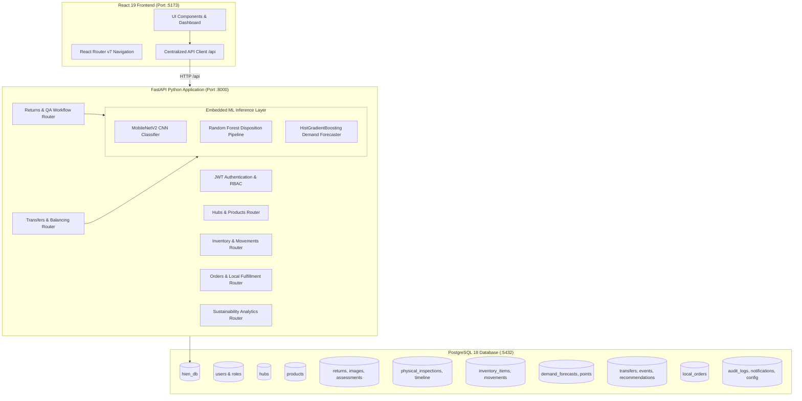

# HIEN (Hyperlocal Inventory Exchange Network) — Comprehensive System & Operator Guide

> **Core Philosophy**: *"Turn verified returns into the right local inventory — only when it makes sense. Don't just process the return: decide its best next move."*

---

## Table of Contents
1. [Executive Summary & System Vision](#1-executive-summary--system-vision)
2. [End-to-End Architecture & Tech Stack](#2-end-to-end-architecture--tech-stack)
3. [How to Run & Access the System](#3-how-to-run--access-the-system)
4. [User Roles & Demo Personas](#4-user-roles--demo-personas)
5. [Complete Frontend Views & Detailed Walkthrough](#5-complete-frontend-views--detailed-walkthrough)
   - [5.1 Inspection Portal](#51-inspection-portal)
   - [5.2 Hub Operations Portal](#52-hub-operations-portal)
   - [5.3 Logistics & Transfers Portal](#53-logistics--transfers-portal)
   - [5.4 Impact & Sustainability Analytics](#54-impact--sustainability-analytics)
   - [5.5 Administration & Governance](#55-administration--governance)
6. [Where and How AI Works in HIEN](#6-where-and-how-ai-works-in-hien)
   - [6.1 MobileNetV2 CNN Image Condition Classifier](#61-mobilenetv2-cnn-image-condition-classifier)
   - [6.2 Random Forest Return Disposition Classifier](#62-random-forest-return-disposition-classifier)
   - [6.3 HistGradientBoosting Demand Forecaster](#63-histgradientboosting-demand-forecaster)
   - [6.4 Decision Intelligence & Balancing Optimization Engine](#64-decision-intelligence--balancing-optimization-engine)
7. [How to See, Rerun, and Calculate with AI in the UI](#7-how-to-see-rerun-and-calculate-with-ai-in-the-ui)
8. [Business Rules, Guardrails & Anti-Pattern Protections](#8-business-rules-guardrails--anti-pattern-protections)
9. [Mathematical Formulations & Counterfactual Baseline](#9-mathematical-formulations--counterfactual-baseline)

---

## 1. Executive Summary & System Vision

### The Problem in Traditional Reverse Logistics
In conventional retail and e-commerce, when a customer returns a product to a store or drop-off point, the default operating procedure is to consolidate the item and ship it back to a distant **central distribution center**. There, the item sits in queue, is unboxed, inspected, repackaged, and eventually restocked or liquidated. 

This introduces severe inefficiencies:
- **Long Return-to-Resale Lag**: A return takes **14–21 days** to re-enter circulation.
- **Excess Carbon Emissions & Fuel Waste**: Upwards of **400–600 km** of unnecessary round-trip trucking.
- **High Handling & Logistics Overhead**: Central reverse-logistics costs frequently exceed **$45–$50 per returned unit**.
- **Regional Inventory Imbalances**: A store in Seattle may experience stockouts for an SKU that a customer just returned 5 miles away in Bellevue, yet neither hub is aware of the other's inventory needs.

### The HIEN Solution
**HIEN (Hyperlocal Inventory Exchange Network)** is an AI-assisted reverse-logistics decision-support platform that transforms local retail stores, micro-fulfillment centers (MFCs), and authorized access points into an intelligent, interconnected circular network.

Instead of blind central shipping, HIEN asks:
> *"Given this returned item, its verified condition, nearby customer demand, network stock levels, hub capacity, time constraints, costs, and carbon emissions: what is the single most beneficial next action — and what evidence proves it?"*

### Core Operational Principles
1. **Advisory AI with Human-in-the-Loop Verification**: AI models provide fast diagnostic triage, but **never automatically approve resale**. A certified human inspector must sign off on mandatory safety and quality checks before an item is admitted to sellable stock.
2. **Feasibility Before Scoring**: Every proposed action (local restock, hub transfer, or liquidation) must pass strict constraint filters (capacity, distance, lead time, safe stock levels) before economic or environmental optimization occurs.
3. **Transparent Counterfactual Baselines**: All reported emission reductions (kg CO₂e) and cost savings ($) are calculated against an explicit traditional central-warehouse baseline, never using arbitrary or fabricated metrics.

---

## 2. End-to-End Architecture & Tech Stack



### Technology Matrix
| Layer | Technologies Used | Primary Function |
| :--- | :--- | :--- |
| **Frontend UI** | React 19, TypeScript, Vite, Tailwind CSS v4, Lucide Icons, Recharts, Leaflet | Interactive multi-role dashboards, map views, QA checklists, inspection evidence, charts |
| **Backend API** | Python 3.11, FastAPI, Uvicorn, Pydantic v2, Pydantic-Settings | High-speed RESTful application server, business logic orchestration, transaction control |
| **Database** | PostgreSQL 18.3, Psycopg 3 with Connection Pooling (`psycopg_pool`) | Normalized relational persistence, atomic inventory reservations, audit logs, timelines |
| **Visual AI** | Keras 3.15 with PyTorch 2.14 Backend, PIL, NumPy | MobileNetV2 CNN image condition classification (`mug_condition_classifier.keras`) |
| **Tabular AI** | Scikit-Learn 1.6.1, Joblib, Pandas | Random Forest return eligibility & disposition pipeline (`return_classifier.joblib`) |
| **Forecasting AI**| Scikit-Learn 1.6.1 HistGradientBoostingRegressor, OrdinalEncoder | 7-day SKU-hub demand trajectory forecasting (`model.joblib`, `encoder.joblib`) |

---

## 3. How to Run & Access the System

### Prerequisites
- Windows OS (or Linux/macOS)
- Node.js v20+ and npm
- Python 3.11 (with `.venv` established in project root)
- PostgreSQL 18 running on `localhost:5432` with database `hien_db`

### Step 1: Start the Backend Service
In PowerShell or terminal from `d:\Tech\REC`:
```powershell
# Activate the virtual environment
.venv\Scripts\activate

# Launch the FastAPI Uvicorn server on port 8000
python -m uvicorn backend.app.main:app --host 0.0.0.0 --port 8000 --reload
```
- **Backend Health Check**: [http://localhost:8000/api/health](http://localhost:8000/api/health)
- **Interactive OpenAPI Swagger Docs**: [http://localhost:8000/docs](http://localhost:8000/docs)

### Step 2: Start the Frontend Application
In a separate terminal from `d:\Tech\REC\Frontend`:
```bash
npm run dev
```
- **Web Application Portal**: [http://localhost:5173](http://localhost:5173)

---

## 4. User Roles & Demo Personas

HIEN implements strict Role-Based Access Control (RBAC). The top navigation bar includes an instant **Role Switcher** dropdown for evaluation and demonstration:

| Persona Name | Role Key | Assigned Hub | Primary Responsibilities & Permitted Views |
| :--- | :--- | :--- | :--- |
| **Sarah Chen** | `admin` | *Global* | Network overview, Hub management, Product catalog, User management, Network configuration, Audit logs |
| **Marcus Vance** | `inspector` | `hub-sea-01` (Seattle) | Return triage, AI assessment review, physical QA checklists, mandatory sign-offs, inspection history |
| **Elena Rostova** | `hub_manager` | `hub-bel-02` (Bellevue) | Local inventory oversight, demand forecasting curves, transfer recommendations approval, local order fulfillment |
| **David Kim** | `logistics` | `hub-tac-04` (Tacoma) | Inter-hub transfers dispatch, carrier tracking assignment, in-transit monitoring, exception discrepancy handling |
| **Dr. Arthur Pendelton** | `analytics_viewer` | *Global* | Sustainability metrics, avoided CO₂e emissions, cost avoidance analytics, category disposition trends |

> **Development Credentials**: All seeded accounts can authenticate with password: `password123`.

---

## 5. Complete Frontend Views & Detailed Walkthrough

Below is a detailed guide to every page and view in the frontend, explaining what it does, what data is shown, and how to interpret each component.

---

### 5.1 Inspection Portal

#### A. Inspection Dashboard (`/inspection`)
- **Purpose**: High-level command center for Return Inspection Officers.
- **Key Indicators**:
  - *Pending Assessment Count*: Returns registered but awaiting AI analysis.
  - *Awaiting Physical Inspection Count*: Returns that have received preliminary AI triage and are queued at physical QA workbenches.
  - *Resale Acceptance Rate (%)*: Percentage of returned items cleared for shelf restock.
  - *Quarantine Alert Banner*: Alerts officers if hazardous, leaking, or electrically defective units require isolation.
- **Interactive Action**: One-click quick links to initiate physical inspection for the top priority items in queue.

#### B. New Return Registration (`/inspection/new`)
- **Purpose**: Registers a newly dropped-off returned item at a local hub counter.
- **Form Fields & Controls**:
  - *Product SKU Selector*: Auto-fills product name, brand, original retail value, and required QA checks.
  - *Receiving Hub*: Sets the initial intake location (e.g., Seattle Central QA Hub).
  - *Order Reference & Quantity*: Links to original customer receipt.
  - *Return Reason*: Categorized dropdown (e.g., *Customer Changed Mind*, *Defective Hardware*, *Cosmetic Dislike*).
  - *Reported Condition*: Dropdown (*Unopened*, *Like New*, *Minor Wear*, *Damaged*, *Defective*).
  - *Packaging Condition*: (*Intact*, *Opened - Good*, *Damaged*, *Missing*).
  - *Accessory Completeness*: (*Complete*, *Partial*, *Missing*).
  - *Evidence Photo Upload*: Uploads photographic evidence directly to `backend/uploads/` via multipart form-data.
- **Result on Submit**:
  - Assigns a unique tracking identifier (e.g., `ret-1053`) and an official RMA number (e.g., `RMA-2026-8491`).
  - Creates the return in PostgreSQL in `registered` status.
  - Automatically logs the first lifecycle creation event in the item's digital timeline.

#### C. Returns Directory (`/inspection/returns`)
- **Purpose**: Searchable, filterable list of all network return items.
- **Filters**:
  - Hub filter (All Hubs vs. specific store).
  - Lifecycle Status filter (`registered`, `assessment_pending`, `approved_resale`, `refurbishment_required`, `quarantined`, `not_suitable`, `rejected`).
  - Product Category filter.
  - Search input: Real-time fuzzy query across RMA number, order ID, product name, and SKU.
- **Visual Badges**: Color-coded status pills indicating whether an item is sellable (green), awaiting triage (amber), or quarantined (red).

#### D. Return Detail & Digital Passport (`/inspection/returns/:id`)
- **Purpose**: The "Digital Product Passport" for a physical returned unit.
- **Key Sections**:
  - *Product Overview Card*: Item photo, SKU, variant, category, current hub location, and intake timestamp.
  - *Condition & Intake Metadata*: Shows customer-reported reason and packaging status.
  - *Lifecycle Timeline*: Chronological vertical timeline tracking every movement, AI prediction, physical inspection, and transfer from creation to final disposition.
  - *Action Bar*: Contextual action buttons: **"Run AI Assessment"**, **"Perform Physical Inspection"**, or **"Print RMA Label"**.

#### E. AI Condition Assessment View (`/inspection/returns/:id/assessment`)
- **Purpose**: Shows the AI model's preliminary triage and diagnostics before physical unboxing.
- **What Appears on Screen**:
  - *Predicted Disposition Banner*: Displays `Approved for Resale`, `Refurbishment Required`, or `Quarantine Recommended`.
  - *Confidence Score Gauge*: Radial meter displaying overall model confidence (e.g., 88.5%).
  - *Class Probability Breakdown*: Stacked horizontal distribution bar showing:
    - Resale Probability (e.g., 88%)
    - Refurbishment Probability (e.g., 8%)
    - Quarantine Probability (e.g., 3%)
    - Not Suitable / Liquidation Probability (e.g., 1%)
  - *Automated Visual Defect Tags*: Highlights flaws detected via the MobileNetV2 CNN or defect heuristics (e.g., *"Micro-abrasion on casing"*, *"Factory seal intact"*).
  - *Risk Flags & Missing Features*: Flags cases where confidence $< 65\%$ or high-value items requiring acoustic/electrical bench testing.
  - *Recommended Next Action*: Advisory instructions for the physical inspector (e.g., *"Perform full acoustic sweep and ear-pad sanitization"*).
  - *Model Provenance Tag*: Displays active model name and version (e.g., `RandomForest-Disp-v1.0.0 / MobileNetV2-CNN`).

#### F. Physical QA Inspection Workspace (`/inspection/returns/:id/inspect`)
- **Purpose**: The mandatory human verification workstation where an authorized officer inspects the unit.
- **Inspection Checklist Components**:
  - Mandatory Checkpoints (marked with red asterisk `*`): Physical casing integrity, factory power/boot test, cryptographic wipe verification, hygiene sanitization.
  - Optional Checkpoints: Packaging grade, accessory completeness.
  - Pass/Fail Toggle Buttons: Each item must be explicitly marked **Pass** or **Fail**.
  - Inspector Notes Area: Free-form text box for technician commentary.
  - Final Disposition Dropdown: `approved_resale`, `refurbishment_required`, `not_suitable`, `quarantined`.
- **System Guardrail Enforcement**:
  - If the inspector attempts to select `approved_resale` while **any mandatory checkpoint has failed or remains uninspected**, the system triggers a **hard block (HTTP 422)**.
  - If approved, the backend executes an atomic transaction that promotes the return to `approved_resale`, updates the timeline, and **immediately restocks the unit into the hub's local sellable inventory pool**.

---

### 5.2 Hub Operations Portal

#### A. Hub Dashboard (`/hub`)
- **Purpose**: Daily operations overview for the Store/Hub Manager.
- **Key Metrics**:
  - *Available Units*: Total sellable units in local stock.
  - *Reserved Units*: Units allocated to active customer orders awaiting pickup.
  - *Incoming Stock*: Units currently dispatched from other hubs in-transit.
  - *Hub Capacity Meter*: Linear progress bar showing current storage utilization against physical maximum (e.g., 1,840 / 2,500 units = 73.6%).

#### B. Local Inventory Management (`/hub/inventory`)
- **Purpose**: Granular view of all SKU inventory held at the hub.
- **Columns & Data**:
  - SKU & Product Name.
  - Storage Location: Exact shelf / bin location (e.g., `Aisle 3, Shelf B2`).
  - Total, Available, Reserved, and Incoming quantities.
  - Disposition State: `sellable`, `quarantined`, or `refurbishment`.
  - Target Stock & Forecasted 7-Day Demand.
  - Stock Level Health Indicator: Visual badge highlighting **Low Stock** (red alert when stock $\le 40\%$ of target) or **Excess Stock** (blue alert when stock $\ge 150\%$ of target).
- **Interactive Action**: Manual adjustment drawer for auditing stock quantities or changing storage bin locations.

#### C. Demand Forecasting Intelligence (`/hub/forecast`)
- **Purpose**: Visualizes expected 7-day customer demand per SKU to plan inventory stocking.
- **What the Graph Displays**:
  - *Solid Blue Line*: Observed historical demand over the past 14 days.
  - *Dashed Purple Line*: Model-projected demand for the upcoming 7 days generated by `HistGradientBoostingRegressor`.
  - *Shaded Envelope Area*: 80% upper and lower statistical confidence bounds.
- **Forecast Metric Badges**:
  - *MAPE (Mean Absolute Percentage Error)*: Typically 7.8% – 8.5%.
  - *RMSE (Root Mean Square Error)*: Typically 1.6 – 1.8 units.
  - *Stock Health Calculation*:
    $$\text{Expected Position} = \text{Available Stock} - \sum \text{Predicted 7-Day Demand}$$
    - If negative: displays a **Projected Shortage** warning in red.
    - If significantly positive: displays a **Projected Surplus** badge in blue.
- **Interactive Action**: **"Recalculate Forecast"** button invokes real-time backend ML inference.

#### D. Inventory Balancing Recommendations (`/hub/recommendations`)
- **Purpose**: Autonomous decision engine that pairs hubs with surplus stock to nearby hubs experiencing shortages.
- **Recommendation Card Anatomy**:
  - *Source Hub & Available Surplus*: e.g., Seattle Central Hub (Surplus: +18 units).
  - *Destination Hub & Shortage*: e.g., Bellevue Tech Exchange (Shortage: -8 units).
  - *Recommended Transfer Quantity*: e.g., 6 units.
  - *Corridor Distance & Transit Duration*: Calculated via Haversine formula (e.g., 18.2 km, 0.9 hours).
  - *Financial & Environmental Breakdown*:
    - Estimated Transport Cost (van courier @ $1.25/km): $22.75
    - Handling Cost: $5.00
    - Carbon Emissions (van courier @ 0.192 kg CO₂e/km): 3.49 kg CO₂e
    - Expected Benefit (avoided central depot processing & avoided stockout): $159.50
    - **Net Economic Benefit**: $+\$131.75$
  - *Constraint Validation Checklist*: Green ticks confirming that the source hub retains safe minimum stock and destination has capacity.
  - *AI Rationale Statement*: Natural language summary explaining why this transfer was chosen over central warehouse routing.
- **Interactive Action**:
  - **"Approve Transfer"**: Immediately creates an official transfer record in `transfers` and reserves stock at the source.
  - **"Reject"**: Allows manager to decline with an audited reason.
  - **"Generate Recommendations"**: Runs the balancing engine across all inventory and forecasts.

#### E. Local Order Fulfillment (`/hub/orders`)
- **Purpose**: Fulfill local customer purchases from verified returned and restocked inventory.
- **Order Lifecycle States**:
  - `pending`: Order placed, inventory available.
  - `reserved`: Inventory transactionally locked to prevent double-allocation.
  - `prepared`: Order packaged and boxed by store staff.
  - `ready_for_pickup`: Customer notified that item is waiting at counter.
  - `fulfilled`: Order completed and handed to customer.
  - `cancelled`: Order aborted; reserved inventory is automatically released back to sellable available stock.
- **Interactive Workflow**:
  - Click **"Reserve Stock"** to lock the item.
  - Click **"Prepare Order"** $\rightarrow$ **"Ready for Pickup"** $\rightarrow$ **"Complete Fulfillment"**.

---

### 5.3 Logistics & Transfers Portal

#### A. Logistics Dashboard (`/logistics`)
- **Purpose**: Command screen for Regional Logistics Operators managing fleet couriers.
- **Key Gauges**: Active In-Transit Shipments, Today's Completed Dispatches, Pending Pickups, Exception Rate.

#### B. Transfer Dispatch Management (`/logistics/dispatch`)
- **Purpose**: Authorizes and dispatches approved inter-hub transfers.
- **Workflow**:
  - Operator selects an `approved` transfer.
  - Enters Carrier Name (e.g., *Dedicated CleanMile EV Van*) and Carrier Tracking Code (e.g., `TRK-EV-9021`).
  - Clicks **"Dispatch Transfer"**:
    - Deducts units from source hub's available stock.
    - Adds units to destination hub's `incomingQuantity`.
    - Sets transfer status to `dispatched` / `in_transit`.
    - Logs a formal dispatch event in the transfer tracking history.

#### C. Transfer Receipt & Exception Handling (`/hub/transfers/:id`)
- **Purpose**: Receiving hub inspects arriving courier shipments.
- **Receipt Workflow**:
  - Operator enters: *Intact Units Received*, *Damaged in Transit Units*, *Missing Units*.
  - **Normal Receipt**: If all units arrive intact, status becomes `received`. Units are added to destination sellable stock and deducted from incoming stock.
  - **Exception Handling**: If damaged units are entered (e.g., 1 unit damaged in transit), the status transitions to `exception`. The intact units become sellable, while the damaged unit is **automatically isolated into a Quarantined inventory pool** with location `Quarantine Staging Bay Q-1` to prevent accidental resale!

---

### 5.4 Impact & Sustainability Analytics

#### Impact Analytics Dashboard (`/analytics`)
- **Purpose**: Computes and demonstrates the verified carbon and economic benefits of HIEN over the traditional central warehouse baseline.
- **Top KPI Cards**:
  1. **Total Returns Processed**: Count of units handled across all hubs.
  2. **Resale Eligibility Rate**: % of returns successfully resold locally without central shipping.
  3. **CO₂e Emissions Avoided**: Total kilograms of greenhouse gas emissions eliminated.
  4. **Logistics Cost Avoided**: Total dollars saved compared to central reverse round-trips.
  5. **Transport Distance Avoided**: Total road kilometers eliminated.
  6. **Turnaround Time Comparison**: **1.4 days (HIEN)** vs. **15.2 days (Central Baseline)**.
- **Analytical Charts**:
  - *Monthly Cost & Emission Trends* (Bar & Line chart): Compares central baseline logistics spend against HIEN hyperlocal spend over the past 6 months.
  - *Hub Performance Comparison* (Horizontal Bar chart): Avoided carbon and cost broken down by individual hub.
  - *Return Volume by Category* (Donut chart): Distribution of returns and resale clearance rates across Consumer Electronics, Audio, Wearables, Computing, and Smart Home.
- **Methodology Drawer**: Transparently discloses calculation formulas, vehicle emissions factors, and baseline round-trip assumptions.

---

### 5.5 Administration & Governance

#### A. Admin Dashboard (`/admin`)
- Network-wide metrics, active hub count, total catalog SKUs, and system health status.

#### B. Hub Management (`/admin/hubs`)
- Add new stores/access points, edit geographic coordinates (latitude/longitude for Haversine routing), capacity limits, and certified handling capabilities (e.g., *Battery Diagnostic Chamber*, *UV Sanitization Pod*).

#### C. Product Catalog (`/admin/products`)
- Define new SKUs, retail pricing, inspection requirement checklists, and return policies.

#### D. User Management (`/admin/users`)
- Manage team members, toggle active/inactive status, and assign primary store hubs.

#### E. Network Configuration (`/admin/config`)
- Adjust dynamic simulation parameters:
  - *Planning Horizon* (default: 14 days)
  - *Min Expected Transfer Benefit* (default: $35.00)
  - *Transport Cost per Km* (default: $1.25/km)
  - *Emissions Factor* (default: 0.192 kg CO₂e/km)
  - *Central Warehouse Baseline Distance* (default: 420.0 km)
  - *Central Warehouse Baseline Cost* (default: $48.50/unit)

#### F. Audit Logs (`/admin/audit`)
- Immutable, searchable historical log of every administrative, inventory, and status event with actor, timestamp, previous state, new state, and success/failure status.

---

## 6. Where and How AI Works in HIEN

HIEN integrates **three distinct machine learning models** operating alongside a **multi-objective decision optimization engine**.

```
┌────────────────────────────────────────────────────────────────────────┐
│                        HIEN AI & Decision Stack                        │
├──────────────────────────────────┬─────────────────────────────────────┤
│ 1. MobileNetV2 CNN               │ Computer vision condition triage    │
│    (mug_condition_classifier)    │ Input: Image → [Defective vs Good]  │
├──────────────────────────────────┼─────────────────────────────────────┤
│ 2. Random Forest Classifier      │ Structured return disposition       │
│    (return_classifier.joblib)    │ Input: 27 Features → Resale/Refurb  │
├──────────────────────────────────┼─────────────────────────────────────┤
│ 3. HistGradientBoosting          │ 7-day SKU demand trajectory         │
│    (DemandForecaster)            │ Input: Lags & Rolling → Demand Qty  │
├──────────────────────────────────┼─────────────────────────────────────┤
│ 4. Balancing Decision Engine     │ Multi-hub transfer optimization     │
│    (Haversine + Economic Margin) │ Input: Stock + Forecast → Transfers │
└──────────────────────────────────┴─────────────────────────────────────┘
```

---

### 6.1 MobileNetV2 CNN Image Condition Classifier
- **Artifact**: [models/cnn/mug_condition_classifier.keras](file:///d:/Tech/REC/models/cnn/mug_condition_classifier.keras) (11.59 MB)
- **Role in Workflow**: Automated visual intake triage for returned products.
- **Architecture**: MobileNetV2 feature extractor backbone with GlobalAveragePooling2D, Dense(128, ReLU), Dropout(0.2), and Dense(2, Softmax).
- **Preprocessing Pipeline**:
  1. Decodes uploaded JPG/PNG image bytes.
  2. Ensures standard 3-channel RGB format.
  3. Bilinear resize to exact shape: `(224, 224, 3)`.
  4. Scales pixel values to float32 range: $[0.0, 1.0]$.
- **Inference Outputs**:
  - Class 0: `defective` probability
  - Class 1: `good` probability
- **Service File**: [backend/app/ml/cnn_service.py](file:///d:/Tech/REC/backend/app/ml/cnn_service.py)
- **API Endpoint**: `POST /api/assessments/predict-condition`

---

### 6.2 Random Forest Return Disposition Classifier
- **Artifact**: [models/hien_artifacts random forest/return_classifier.joblib](file:///d:/Tech/REC/models/hien_artifacts%20random%20forest/return_classifier.joblib) (12.45 MB)
- **Role in Workflow**: Evaluates structured return intake features and customer reasons to predict the most likely viable disposition.
- **Input Feature Schema (27 Features)**:
  - *16 Numeric*: `product_age_months`, `original_product_value`, `return_days_after_purchase`, `packaging_damage_score`, `accessories_expected`, `accessories_present`, `accessory_completeness_percentage`, `missing_accessory_count`, `functional_test_available`, `physical_damage_score`, `visible_defect_count`, `return_shipping_distance_km`, `handling_history_count`, `previous_return_count`, `safety_check_required`, `manual_inspection_required`.
  - *11 Categorical*: `product_category`, `brand`, `return_reason`, `customer_reported_condition`, `packaging_condition`, `functional_test_type`, `physical_condition`, `return_hub_id`, `hub_type`, `product_risk_level`.
- **Target Classes**:
  - `0`: `not_resalable` $\rightarrow$ mapped to `not_suitable`
  - `1`: `refurbishment_needed` $\rightarrow$ mapped to `refurbishment_required`
  - `2`: `resalable` $\rightarrow$ mapped to `approved_resale`
- **Uncertainty Guardrail**:
  If predicted confidence $< 0.65$ ($65\%$), the model automatically sets:
  ```json
  "review_recommended": true
  ```
  This surfaces a prominent warning in the UI mandating that human QA conduct exhaustive bench testing before clearance.
- **Service File**: [backend/app/ml/return_rf_service.py](file:///d:/Tech/REC/backend/app/ml/return_rf_service.py)
- **API Endpoint**: `POST /api/assessments/predict-disposition`

---

### 6.3 HistGradientBoosting Demand Forecaster
- **Artifacts**: [models/hist model/model.joblib](file:///d:/Tech/REC/models/hist%20model/model.joblib) & [encoder.joblib](file:///d:/Tech/REC/models/hist%20model/encoder.joblib)
- **Role in Workflow**: Projects forward 7-day demand for each SKU at each hub so the system knows whether returned stock will sell locally or should be transferred.
- **Feature Engineering Pipeline**:
  1. Chronological sorting by `[hub_id, product_id, date]`.
  2. Median and modal imputation for missing competitor prices or local event flags.
  3. **Lag Features**: `demand_7d_lag_1` and `demand_7d_lag_2`.
  4. **Rolling Window Features**: 3-day rolling mean (`demand_7d_roll_mean_3`) and 3-day rolling standard deviation (`demand_7d_roll_std_3`).
  5. **Ordinal Encoding**: Encodes `day_of_week`, `hub_id`, `hub_type`, `city`, `product_id`, `product_category`, `festival`, `season`.
  6. **Non-Negative Rectification**: Predictions clipped to $\ge 0$ via `np.clip(preds, 0, None)`.
- **Service File**: [backend/app/ml/demand_forecasting_service.py](file:///d:/Tech/REC/backend/app/ml/demand_forecasting_service.py)
- **API Endpoint**: `POST /api/forecasts/run`

---

### 6.4 Decision Intelligence & Balancing Optimization Engine
- **Role in Workflow**: Evaluates the network as a whole to recommend optimal stock balancing moves.
- **Algorithm**:
  1. Identifies **Surplus Hubs** where:
     $$\text{Available Stock} > 1.5 \times \text{Target Stock}$$
  2. Identifies **Shortage Hubs** where:
     $$\text{Available Stock} < 0.4 \times \text{Target Stock}$$
  3. Computes Great-Circle road distance using the **Haversine Formula**:
     $$d = 2R \arcsin\left(\sqrt{\sin^2\left(\frac{\Delta \text{lat}}{2}\right) + \cos(\text{lat}_1)\cos(\text{lat}_2)\sin^2\left(\frac{\Delta \text{lon}}{2}\right)}\right)$$
  4. Calculates full cost-benefit equation:
     $$\text{Net Benefit} = \text{Avoided Central Depot Cost} + \text{Avoided Stockout Value} - \text{Transport Cost} - \text{Handling Cost}$$
  5. Only recommends the transfer if **Net Benefit $> \$35.00$** and all hard feasibility checks pass.

---

## 7. How to See, Rerun, and Calculate with AI in the UI

Here is an exact step-by-step walkthrough to test and demonstrate all AI capabilities directly in your browser:

### Scenario 1: Trigger AI Condition Assessment on a Return
1. In the top nav, switch role to **Inspector (Marcus Vance)**.
2. Navigate to **Return Directory** (`/inspection/returns`).
3. Click on any return in `registered` status (e.g., `ret-1001` or `ret-1004`).
4. Click the blue button: **"Run AI Pre-Assessment"**.
5. **What Happens Behind the Scenes**:
   - The frontend calls `POST /api/assessments/run/:returnId`.
   - The backend runs `return_rf_service.predict()` using the return's category, reported condition, and packaging status.
   - It also queries `cnn_service` on the attached evidence photo.
   - The assessment card instantly updates with predicted disposition, class probabilities bar, defect labels, and advisory next steps.
   - A new assessment entry is appended to the item's digital timeline.

### Scenario 2: Rerun Real-Time Demand Forecasting
1. Switch role to **Hub Manager (Elena Rostova)**.
2. Navigate to **Demand Forecast** (`/hub/forecast`).
3. Select an SKU from the dropdown (e.g., `SKU-AUD-801` - AcoustiPro Headphones).
4. Click the button: **"Recalculate Forecast (Run ML Model)"**.
5. **What Happens Behind the Scenes**:
   - The frontend calls `POST /api/forecasts/run` with `{ sku, hubId }`.
   - The backend invokes `DemandForecastingService`, runs the `HistGradientBoostingRegressor`, and computes a new 7-day trajectory.
   - The chart animates, updating the dashed purple prediction line and confidence bounds.
   - The expected shortage/surplus counter updates dynamically based on current available inventory.

### Scenario 3: Generate Inter-Hub Inventory Balancing Recommendations
1. As **Hub Manager** or **Admin**, navigate to **Transfer Recommendations** (`/hub/recommendations`).
2. Click the button: **"Generate New Recommendations"**.
3. **What Happens Behind the Scenes**:
   - The frontend calls `POST /api/recommendations/generate`.
   - The backend compares all inventory levels against forecasted demand across all 5 hubs.
   - It pairs surplus hubs (e.g., Seattle QA Hub) with shortage hubs (e.g., Bellevue Tech Exchange).
   - It calculates distance, courier transit cost ($1.25/km), carbon emissions (0.192 kg CO₂e/km), and net economic benefit.
   - The newly generated recommendation cards appear on screen with their constraint checklists.
4. Click **"Approve Recommendation"** on any card:
   - Calls `POST /api/recommendations/:id/approve`.
   - Automatically reserves stock at the source hub and generates an official transfer record in `transfers`.

### Scenario 4: Dispatch & Receive Transfer with Exception Handling
1. Switch role to **Logistics Operator (David Kim)**.
2. Navigate to **Transfer Dispatch** (`/logistics/dispatch`).
3. Find the approved transfer, enter Carrier: `CleanMile EV Logistics`, Tracking: `TRK-EV-7701`, and click **"Dispatch Transfer"**.
   - Units are deducted from source stock and marked `in_transit`.
4. Navigate to **Transfer Detail** (`/hub/transfers/:id`).
5. In the receipt drawer, simulate a damaged unit by entering:
   - *Received*: `5`
   - *Damaged in Transit*: `1`
   - *Missing*: `0`
6. Click **"Confirm Delivery Receipt"**:
   - Status updates to **`exception`**.
   - The 5 intact units become sellable at the destination hub.
   - The 1 damaged unit is **automatically isolated into Quarantined Inventory** at `Quarantine Staging Bay Q-1`!

### Scenario 5: Check Dynamic Sustainability & Financial Impact
1. Switch role to **Analytics Viewer (Dr. Arthur Pendelton)**.
2. Navigate to **Sustainability & Impact Analytics** (`/analytics`).
3. Observe how completed returns and hyperlocal transfers dynamically update the live counters for:
   - Avoided Carbon Emissions (kg CO₂e)
   - Avoided Reverse Logistics Cost ($)
   - Avoided Highway Distance (km)
4. To test a "what-if" scenario:
   - Navigate to **Network Config** (`/admin/config`).
   - Change *Transport Cost per Km* from `$1.25` to `$2.50` or change *Central Warehouse Baseline Distance* from `420 km` to `600 km`.
   - Save changes and return to `/analytics`: all savings calculations immediately re-evaluate against the new baseline!

---

## 8. Business Rules, Guardrails & Anti-Pattern Protections

HIEN implements strict domain guardrails to avoid common real-world reverse-logistics failure modes:

1. **Anti-Pattern 1: "AI Decides Resale Directly"**:
   - *Risk*: A biased or hallucinating model clears a broken or contaminated item for resale, leading to customer safety incidents or brand damage.
   - *HIEN Protection*: AI predictions are explicitly classified as **Advisory**. The database and API reject any attempt to admit an item to sellable inventory without a signed `PhysicalInspection` record.
2. **Anti-Pattern 2: "Overriding Mandatory Quality Checkpoints"**:
   - *Risk*: An inspector accidentally or intentionally checks "Resale Approved" despite a failed battery or electrical test.
   - *HIEN Protection*: Hard code-level validation in `InspectionService` and `/api/inspections` scans all checkpoints where `isMandatory == true`. If even one mandatory check is not `passed: true`, the approval is rejected with HTTP 422.
3. **Anti-Pattern 3: "Double-Allocation of Returned Stock"**:
   - *Risk*: An item is simultaneously allocated to an in-store customer order and an inter-hub transfer.
   - *HIEN Protection*: Inventory movements use PostgreSQL transactional locks (`FOR UPDATE`). When an order or transfer is proposed, the quantity is moved immediately from `availableQuantity` to `reservedQuantity`.
4. **Anti-Pattern 4: "Ghost Stock in Transit"**:
   - *Risk*: Stock in transit is counted as available at either the source or destination, resulting in unfulfillable orders.
   - *HIEN Protection*: Dispatched stock is deducted from source `reservedQuantity` and held in `incomingQuantity` at the destination. It does not become `availableQuantity` until receipt is physically acknowledged.
5. **Anti-Pattern 5: "Quarantine Contamination"**:
   - *Risk*: Damaged, leaking, or recalled goods mix with general inventory.
   - *HIEN Protection*: All damaged return intake or transfer transit casualties are given disposition `quarantined` with dedicated quarantine bin assignments and zero sellable quota.

---

## 9. Mathematical Formulations & Counterfactual Baseline

### 1. Haversine Road Distance Calculation
$$\Delta \text{lat} = \text{lat}_2 - \text{lat}_1, \quad \Delta \text{lon} = \text{lon}_2 - \text{lon}_1$$
$$a = \sin^2\left(\frac{\Delta \text{lat}}{2}\right) + \cos(\text{lat}_1)\cos(\text{lat}_2)\sin^2\left(\frac{\Delta \text{lon}}{2}\right)$$
$$c = 2 \cdot \text{atan2}\left(\sqrt{a}, \sqrt{1 - a}\right)$$
$$d_{\text{corridor}} = R \cdot c \quad (R = 6,371.0 \text{ km})$$

### 2. Hyperlocal Transfer Net Benefit Formulation
$$\text{Transport Cost} = d_{\text{corridor}} \times C_{\text{km}} \quad (C_{\text{km}} = \$1.25/\text{km})$$
$$\text{Transport Emissions} = d_{\text{corridor}} \times E_{\text{km}} \quad (E_{\text{km}} = 0.192 \text{ kg CO}_2\text{e/km})$$
$$\text{Avoided Central Leg Benefit} = Q_{\text{transfer}} \times \$18.50 + \$48.50 \text{ (base central handling)}$$
$$\text{Net Benefit} = \text{Avoided Central Leg Benefit} - \text{Transport Cost} - \text{Handling Cost (\$5.00)}$$
$$\text{Feasibility Gate}: \text{Net Benefit} \ge \$35.00 \quad \text{AND} \quad \text{Available}_{\text{source}} - Q \ge \text{Target}_{\text{source}}$$

### 3. Sustainability Impact Counterfactual Baseline
For every return processed and local order fulfilled:
$$\text{Baseline Distance} = (\text{Total Returns} + \text{Local Orders}) \times 420.0 \text{ km (central depot round-trip)}$$
$$\text{Baseline Cost} = (\text{Total Returns} + \text{Local Orders}) \times \$48.50 \text{ (central warehouse processing)}$$
$$\text{Baseline Emissions} = \text{Baseline Distance} \times 0.192 \text{ kg CO}_2\text{e/km}$$

$$\text{HIEN Actual Distance} = \sum_{\text{transfers}} d_{\text{transfer}} + (\text{Fulfilled Orders} \times 8.5 \text{ km courier})$$
$$\text{HIEN Actual Cost} = \sum_{\text{transfers}} \text{Cost}_{\text{transfer}} + (\text{Fulfilled Orders} \times \$12.00)$$
$$\text{HIEN Actual Emissions} = \sum_{\text{transfers}} \text{Emissions}_{\text{transfer}} + (\text{Fulfilled Orders} \times 1.6 \text{ kg CO}_2\text{e})$$

$$\mathbf{Distance Avoided} = \max(0, \text{Baseline Distance} - \text{HIEN Actual Distance})$$
$$\mathbf{Cost Avoided} = \max(0, \text{Baseline Cost} - \text{HIEN Actual Cost})$$
$$\mathbf{CO}_2\mathbf{e \text{ Avoided}} = \max(0, \text{Baseline Emissions} - \text{HIEN Actual Emissions})$$

---

## 10. Summary & File Manifest

| File / Folder | Role in System |
| :--- | :--- |
| [HIEN_COMPLETE_SYSTEM_GUIDE.md](file:///d:/Tech/REC/HIEN_COMPLETE_SYSTEM_GUIDE.md) | **This master document** — complete project explanation and guide |
| [backend/app/main.py](file:///d:/Tech/REC/backend/app/main.py) | FastAPI application entrypoint, CORS, startup lifecycles, health checks |
| [backend/app/ml/cnn_service.py](file:///d:/Tech/REC/backend/app/ml/cnn_service.py) | MobileNetV2 CNN condition classification service |
| [backend/app/ml/return_rf_service.py](file:///d:/Tech/REC/backend/app/ml/return_rf_service.py) | Random Forest return eligibility & disposition classification service |
| [backend/app/ml/demand_forecasting_service.py](file:///d:/Tech/REC/backend/app/ml/demand_forecasting_service.py) | HistGradientBoostingRegressor demand forecasting service |
| [backend/app/routers/](file:///d:/Tech/REC/backend/app/routers) | Modular REST route handlers (returns, inventory, forecasts, transfers, orders, analytics) |
| [database/schema.sql](file:///d:/Tech/REC/database/schema.sql) | Complete normalized DDL schema for PostgreSQL 18 |
| [database/seed.py](file:///d:/Tech/REC/database/seed.py) | Reproducible database seed script |
| [Frontend/src/services/apiClient.ts](file:///d:/Tech/REC/Frontend/src/services/apiClient.ts) | Centralized typed HTTP API client connecting React to FastAPI |
| [Frontend/vite.config.ts](file:///d:/Tech/REC/Frontend/vite.config.ts) | Vite dev proxy routing `/api` requests to backend port 8000 |
| [backend/test_api.py](file:///d:/Tech/REC/backend/test_api.py) | Comprehensive test suite testing all APIs and real ML models |
